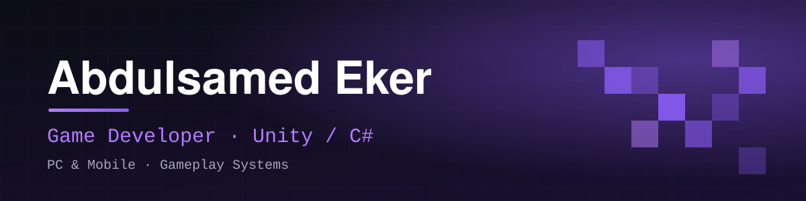

# Hi, I'm Abdulsamed 👋

**Game Developer · Unity / C#** — Digital Game Design student at Istanbul Topkapı University.
I build gameplay mechanics and game systems in C#, for PC and mobile.

- 🎮 4 games & prototypes in Unity and PuzzleScript
- 🧱 **CivBlocks** — mobile city-building puzzle, preparing for Google Play
- 🚀 **Uzay Yarışı** — split-screen space racing, in development
- 🌐 Portfolio: **[abdulsamedeker.com](https://abdulsamedeker.com)**

### 🛠️ Tech & Tools

### 🚀 Featured Projects

| Project | What it is |
| --- | --- |
| **CivBlocks** | Mobile city-building puzzle · Android · 4-person team · Google Play release in preparation |
| **Uzay Yarışı** | Two-player split-screen space racer · lobby, nitro, power-ups, minimap · in development |
| **Captain's Chronicles** | Island exploration with museums · survival system, inventory, NavMesh NPCs · solo project |
| **MagnoBot** | Magnet-based puzzle · built with PuzzleScript · playable in the browser on itch.io |
| **[MergeGame](https://github.com/Abdulsamed00/MergeGame)** | Merge game · university project |
| **[Metroidvania Adventure](https://github.com/Abdulsamed00/Metroidvania_Adventure_Repo)** | Metroidvania-style adventure |

**More games on [itch.io](https://abdulsamed-eker.itch.io)**

### 🔗 Links

### 📊 GitHub Stats

